# Brief 22's Pages On The Built App, In The Order A Player Meets Them

The same pages on a phone, 390 wide: `mobile/README.md`.

Sixteen pages, each captured whole, at the owner's word on 2026-10-23 ("send full page captures of each full page in
chronological order while also pushing said captures to github"). They were captured on the app built from `main` at
`58231c69`, which holds brief 22 (#54) and its follow-up (#56). Each page is shown 1440 wide at twice the pixels, the
window grown until the page fit.

The pages come from four saves, each made on `main`'s code and opened as a player opens one (Continue):
- **A new student, 1 September 2026:** `../app/make-saves.ts`.
- **b20-4, the international graduate, at 5 PM on 16 August 2029:** b20-4's own journey (`tools/b20-journeys.ts`,
  brief 20's seed and players), replayed and saved the moment the offer for Hester Vane stood, before it was answered.
  It was the same as the final runs' journey line for line to that day. The hook that wrote that save was added to a
  scratch clone's copy of the runner only.
- **b20-4 on 1 September 2029 at 2 PM, and on 2 September at 9 AM:** `../app/make-saves.ts`, from b20-4's save of 1
  September (`tests/fixtures/b22/b20-4-opt-2029-09-01.json.gz`), played on by the clock.

The script that captured them, `tools/cap22.mjs`, was a scratch copy as well. It walks the visible controls only:
Career, Player Profile, Papers, Home's Open Calendar, and How This Works with Show Everything pressed. It found no page
error, no console error and no step it couldn't take.

## A New Student, 1 September 2026

1. **Home.**

   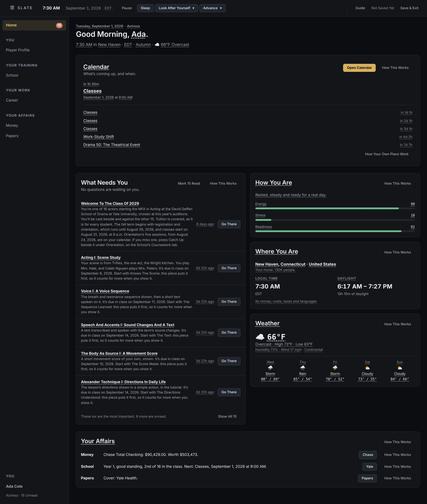
2. **Career, Opportunities.** What It Asks names each genre a role asks once, never a broad genre beside its own kind.

   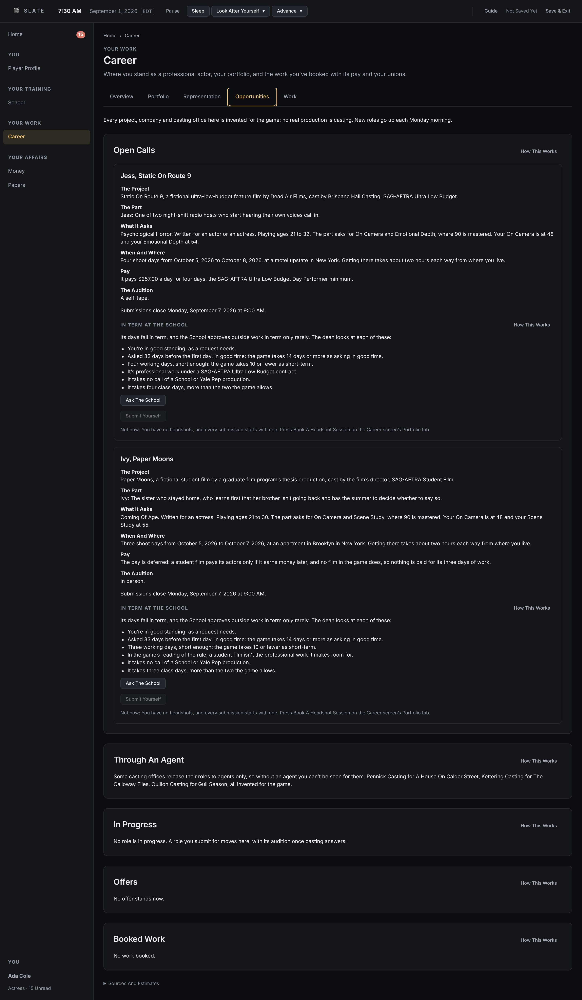
3. **Player Profile.** The Genres panel among the rest.

   
4. **How This Works, Genres.** Related Genres: 65% and 40%, one step only.

   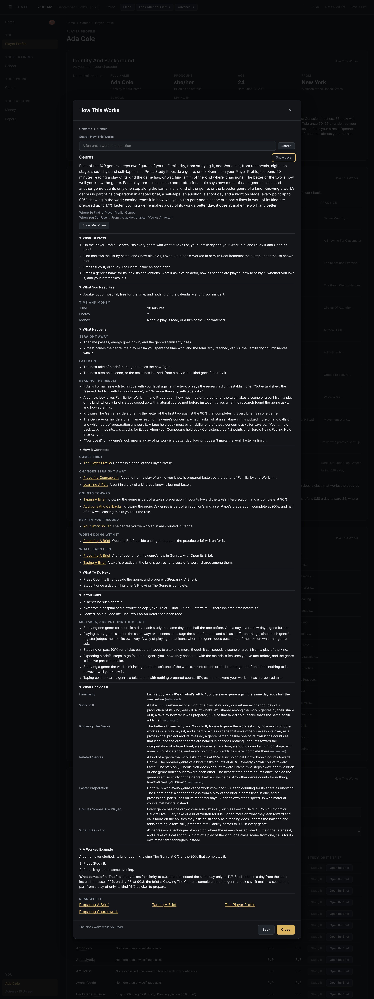

## b20-4, The International Graduate, 16 August 2029, 5 PM

5. **Home.** The offer for Hester Vane in The Winter Ledger, under What Needs You.

   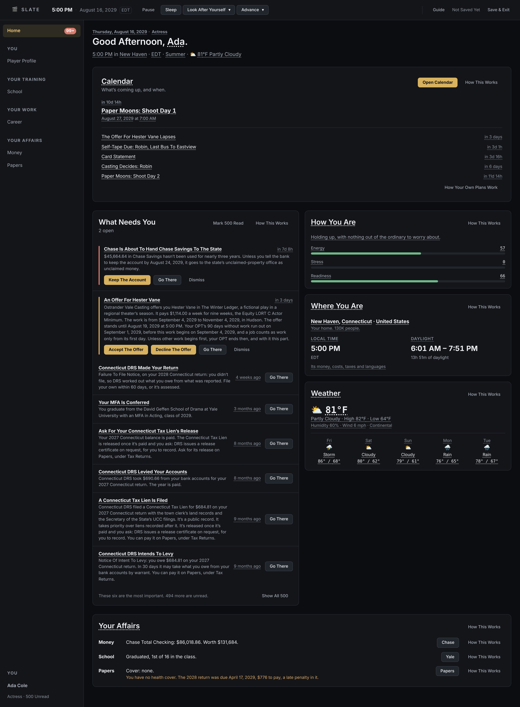
6. **Career, Opportunities.** Above Accept: OPT's 90 days without work run out on 1 September, before the run begins on
   the 4th. Robin's self-tape: "Submitted. The producers answer soon."

   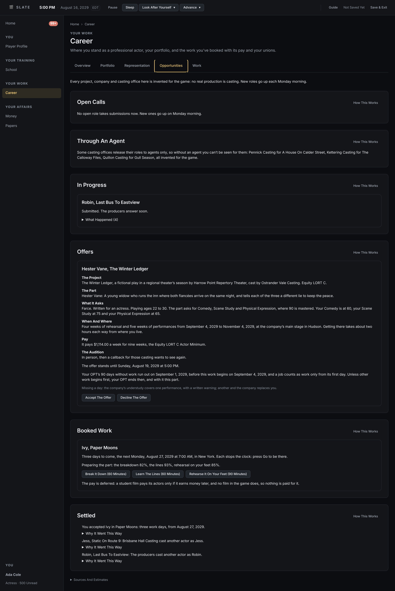
7. **Papers, Permission To Work.** 77 days without work counted, the status ending 1 September.

   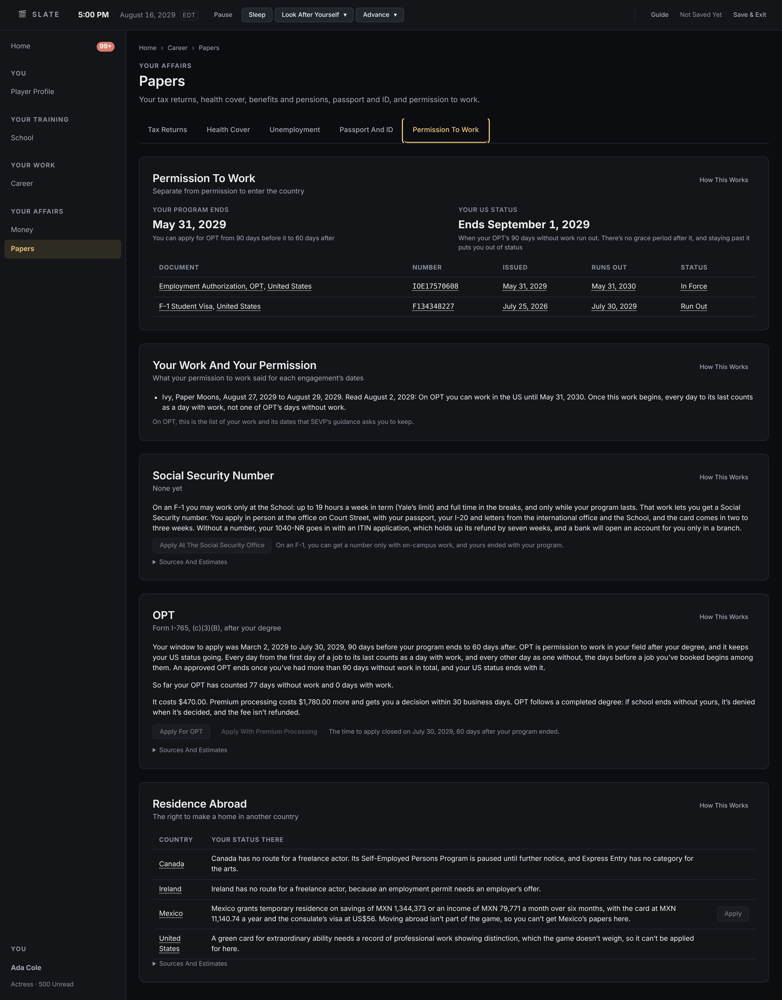

## 1 September 2029, 2 PM: OPT's Last Day, The Winter Ledger Booked

8. **Home.**

   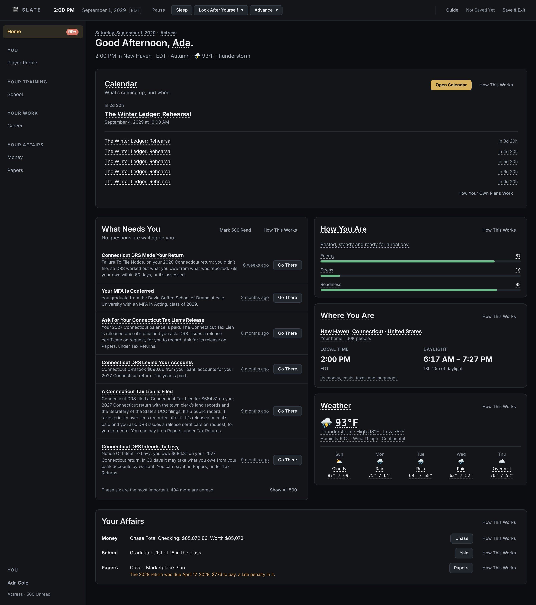
9. **Papers, Permission To Work.** "Ends September 1, 2029."

   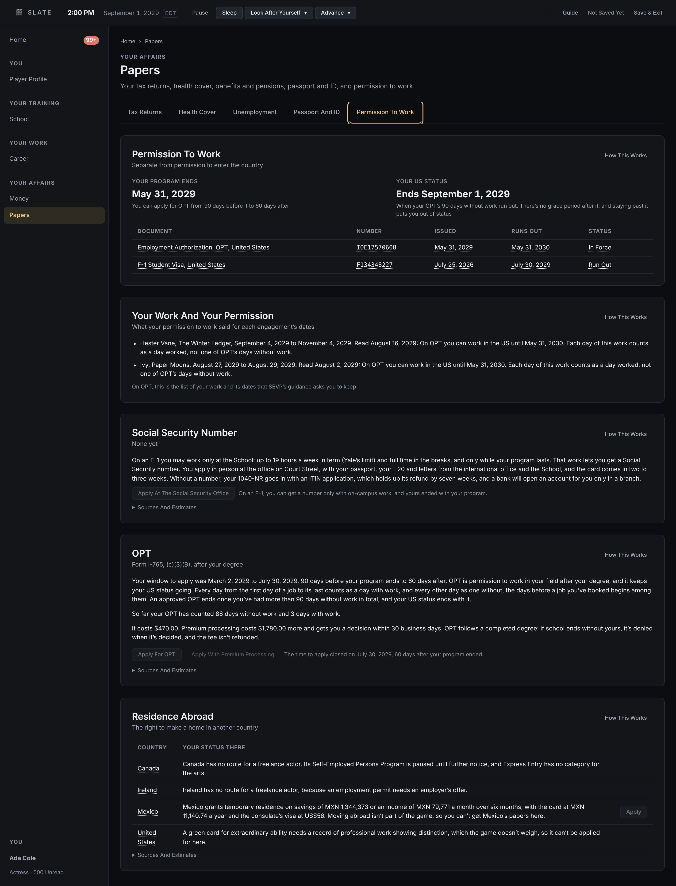
10. **Career, Work.** The Winter Ledger booked, its pay and its calls.

    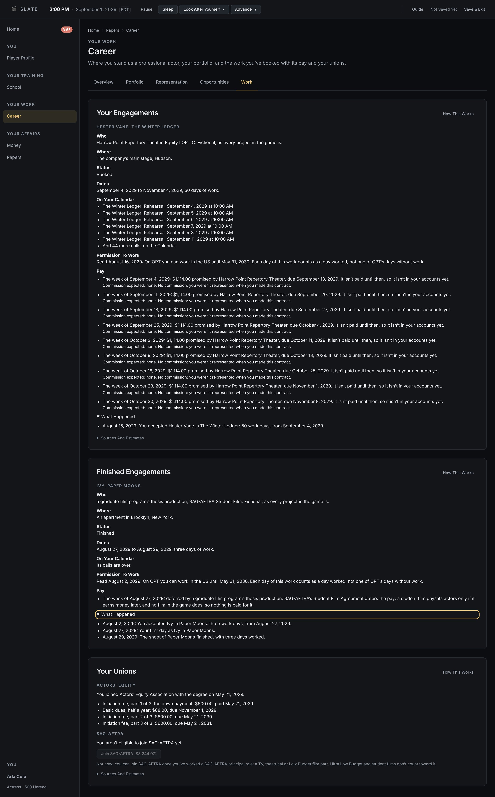
11. **Calendar.** The run's calls and its six paydays in view.

    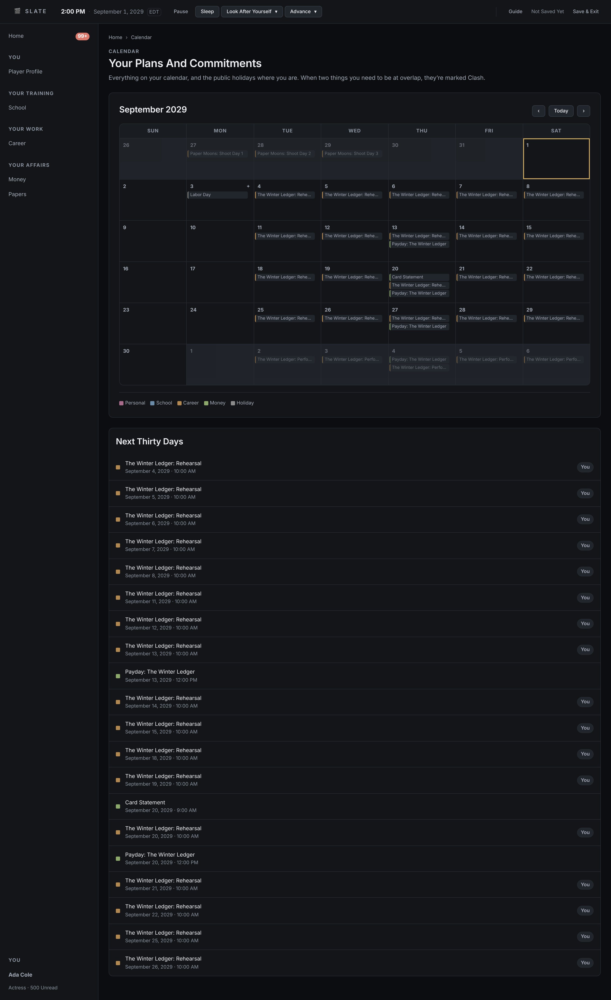

## 2 September 2029, 9 AM: OPT Ended At Midnight, The Run Released

12. **Home.** "Released As Hester Vane", "Out Of Status" and "OPT Ended" under What Needs You; no payday for the run.

    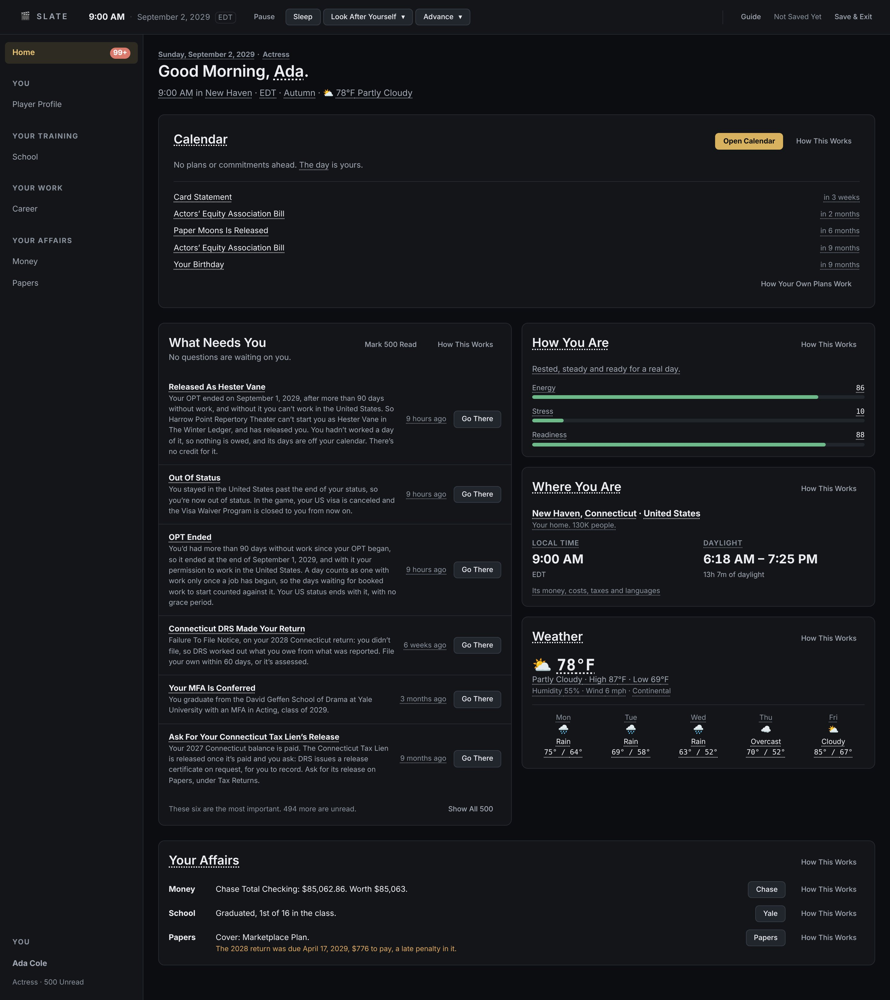
13. **Papers, Permission To Work.** Out Of Status.

    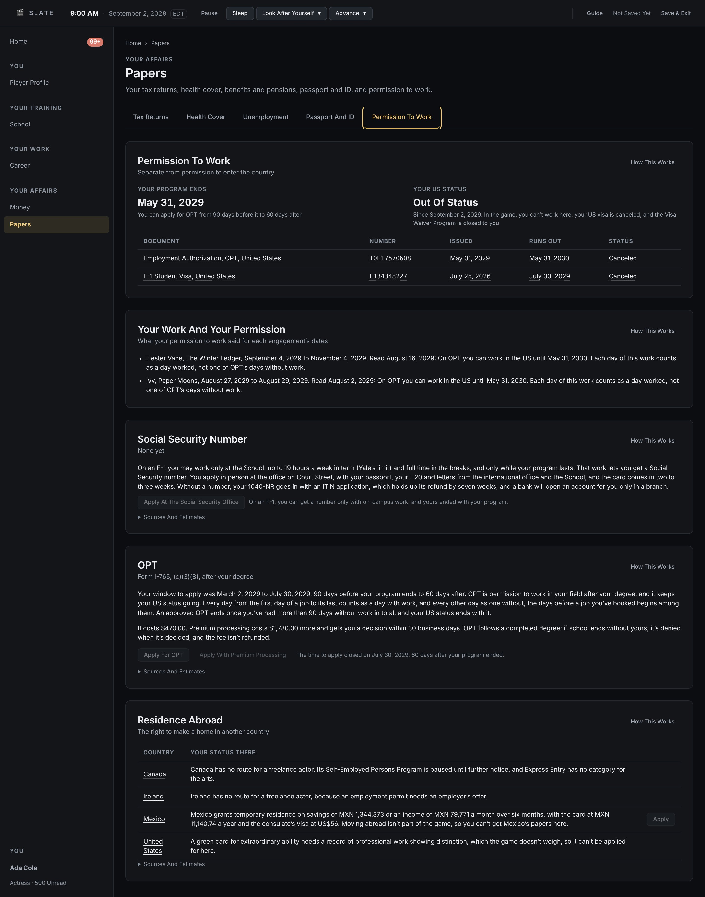
14. **Career, Work.** The Winter Ledger called off, no pay promised, and why.

    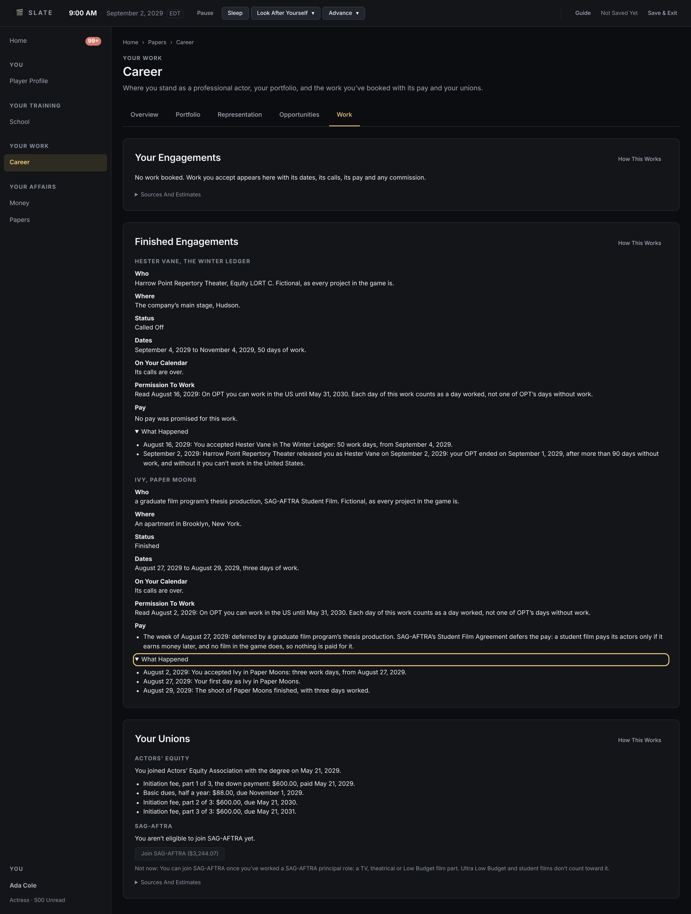
15. **Calendar.** The run's calls and paydays gone.

    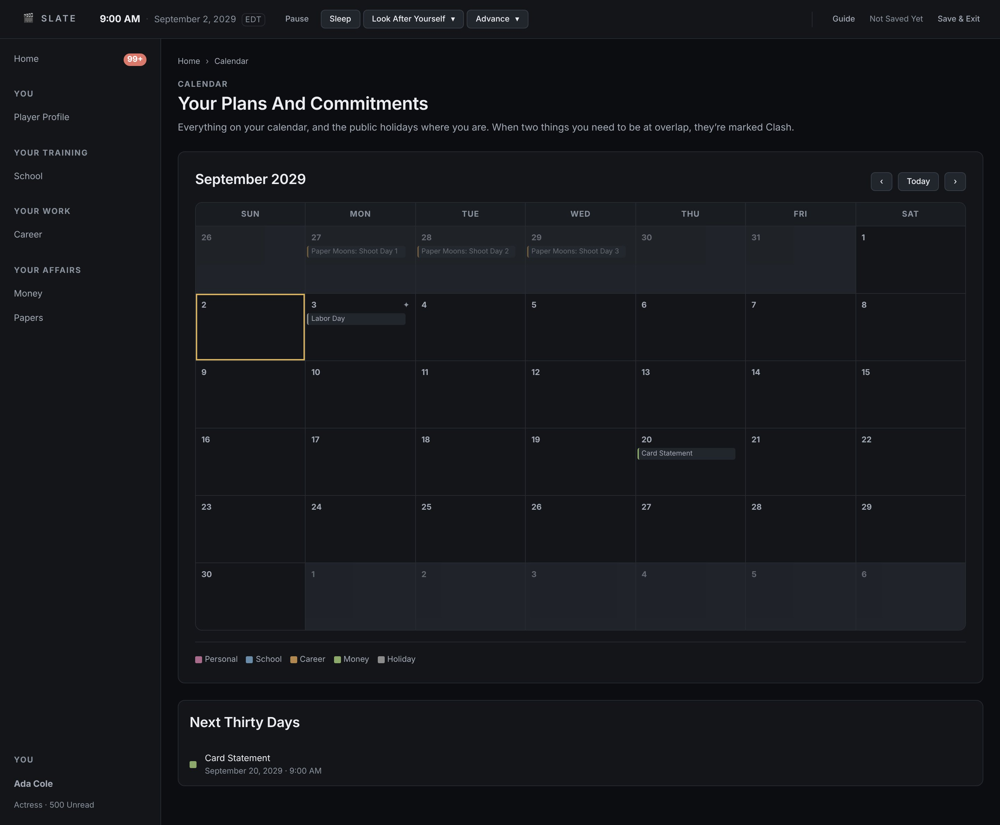
16. **How This Works, Permission To Work.** How OPT is counted, by the day.

    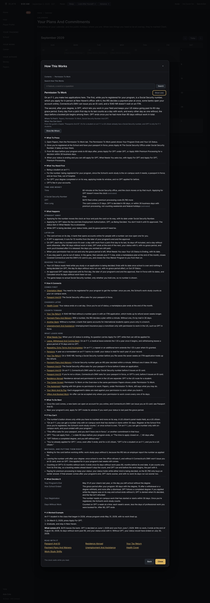
