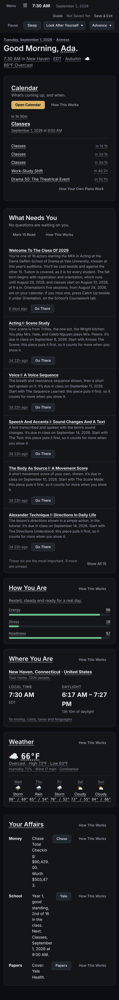
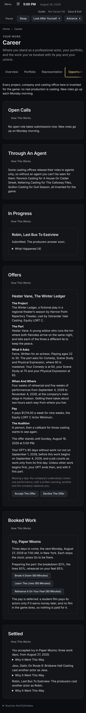
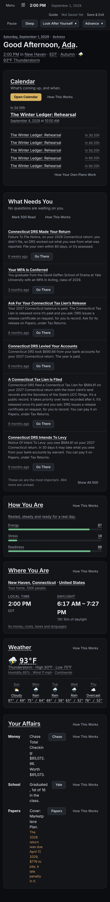
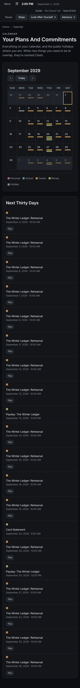
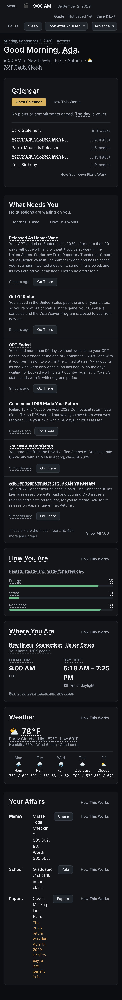
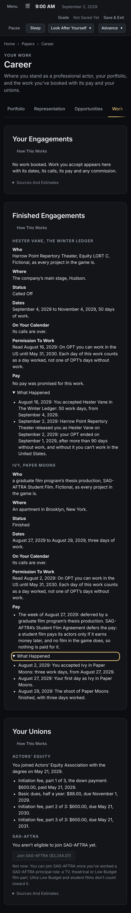
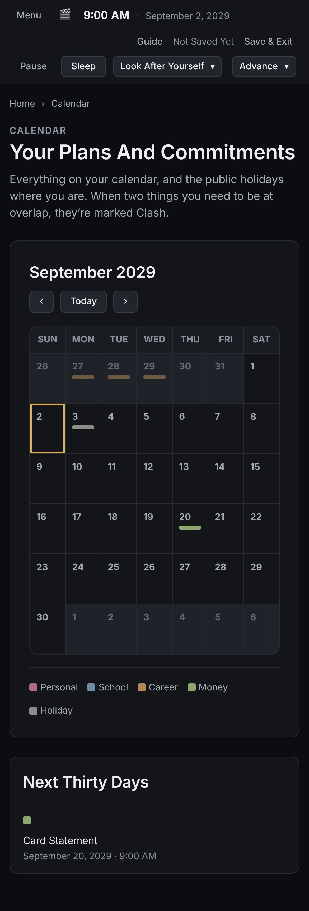

# Brief 22's Pages On A Phone, In The Order A Player Meets Them

The same sixteen pages as `../README.md`, at the owner's word on 2026-10-23 ("Do the same with the captures on mobile as
well"). They come from the same build of `main` at `58231c69` and the same four saves, seen as a phone shows them: 390
by 844 at three times the pixels. The left rail is opened through Menu, as brief 22's walk opens it at 390. Each page is
captured whole. A page taller than 4,400 of the window's pixels is captured in two consecutive parts, and the second
part overlaps the first, so nothing falls between them.

The script, `tools/cap22m.mjs`, was a scratch copy of the desktop one. Walking the visible controls only, it found no
page error, no console error and no step it couldn't take.

Found here, not part of brief 22: at the foot of Home (pages 1, 5, 8 and 12), the Your Affairs rows leave their text a
column so narrow that a word or an amount breaks across lines ("Chase Total Checkin / g", "$90,429. / 00.", "Marketp /
lace"). Nothing scrolls sideways, and that is all the walks at 390 hold.

## A New Student, 1 September 2026

1. **Home.**

   
2. **Career, Opportunities.** What It Asks names each genre a role asks once.

   
3. **Player Profile,** in two parts.

   
   
4. **How This Works, Genres,** in two parts. Related Genres: 65% and 40%, one step only.

   
   

## b20-4, The International Graduate, 16 August 2029, 5 PM

5. **Home.** The offer for Hester Vane, under What Needs You.

   
6. **Career, Opportunities.** Above Accept: OPT's 90 days without work run out on 1 September, before the run begins on
   the 4th. Robin's self-tape: "Submitted. The producers answer soon."

   
7. **Papers, Permission To Work.** 77 days without work counted, the status ending 1 September.

   

## 1 September 2029, 2 PM: OPT's Last Day, The Winter Ledger Booked

8. **Home.**

   
9. **Papers, Permission To Work.** "Ends September 1, 2029."

   
10. **Career, Work.** The Winter Ledger booked, its pay and its calls.

    
11. **Calendar.** The run's calls and its six paydays in view.

    

## 2 September 2029, 9 AM: OPT Ended At Midnight, The Run Released

12. **Home.** "Released As Hester Vane", "Out Of Status" and "OPT Ended"; no payday for the run.

    
13. **Papers, Permission To Work.** Out Of Status.

    
14. **Career, Work.** The Winter Ledger called off, no pay promised, and why.

    
15. **Calendar.** The run's calls and paydays gone.

    
16. **How This Works, Permission To Work,** in two parts. How OPT is counted, by the day.

    
    
